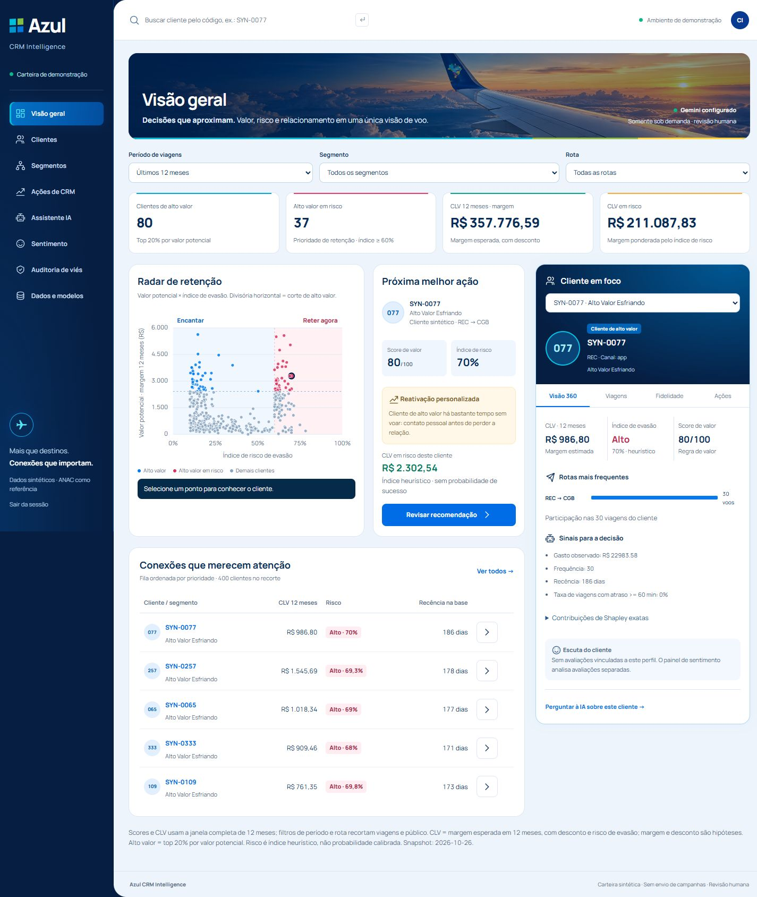

# Azul CRM Intelligence

Uma plataforma de inteligência de relacionamento para identificar clientes de alto valor, entender sinais de evasão e preparar a próxima ação de retenção. **Web responsiva + FastAPI + Gemini**, com ambiente analítico Streamlit preservado, com dados públicos da ANAC e clientes inteiramente sintéticos.

### 🌐 Acesse a plataforma

**🚀 Aplicação online (Render):** [Azul CRM Intelligence](https://azul-crm-intelligence.onrender.com)

Explore o dashboard interativo de inteligência de CRM, com análise de clientes sintéticos, segmentação, previsão de risco de evasão e recomendações de retenção apoiadas por inteligência artificial.

> **Nota:** A aplicação está hospedada no Render. O primeiro acesso pode levar alguns segundos devido à inicialização do serviço.

> **Abrir a interface principal:** no VS Code, use **Executar tarefa → Azul CRM: web** ou execute `python -m uvicorn web.api.index:app --host 127.0.0.1 --port 8503`. Acesse [localhost:8503](http://127.0.0.1:8503). O snapshot sintético já está incluído; não é necessário reprocessar a ANAC para abrir a aplicação.
>
> **Publicar:** siga [o passo a passo da Vercel](docs/VERCEL.md). A pasta raiz do deploy é **web**, com API Python leve, frontend estático e persistência Redis. O ambiente analítico completo continua em [localhost:8501](http://127.0.0.1:8501).



## Interface web e organização

A experiência principal segue a referência visual: navegação azul-marinho, banner de aviação, radar interativo, indicadores, fila de prioridades e cliente em foco. As oito áreas compartilham a carteira calculada: Visão geral, Clientes, Segmentos, Ações de CRM, Assistente IA, Sentimento, Auditoria de viés e Dados e modelos. O layout se adapta a desktop, tablet e celular; respeita redução de movimento e usa fonte local.

| Pasta | Responsabilidade |
|---|---|
| `web/public` | Interface responsiva, estilos e imagens locais |
| `web/api` | API privada compatível com Vercel Functions |
| `web/crm_runtime` | Gemini, sentimento e armazenamento leve |
| `web/data/snapshot.json` | Projeção versionada de dados exclusivamente sintéticos |
| `src/azul_crm` | Motor analítico, pipeline ANAC, regras e contratos |
| `frontend` | Interface Streamlit do ambiente analítico completo |
| `scripts/export_web.py` | Atualização da projeção e dos módulos compartilhados |
| `tests` | Testes de domínio, integração, segurança e versão web |

Na interface web, o Gemini tem **uma tentativa por solicitação, cinco chamadas por dia por padrão, intervalo global de 20 segundos e cache de 20 minutos**. Abrir telas, filtrar clientes, analisar sentimento e aprovar rascunhos não chama a API. Falhas também consomem a cota interna para impedir ciclos de tentativas. Na Vercel, o contador e as decisões são mantidos em Redis externo, compartilhados por todas as instâncias. Localmente, ficam no SQLite ignorado pelo Git.

O snapshot preserva CLV e scores anuais; filtros de período/rota recortam viagens e público. O pipeline não roda durante requisições na Vercel. Para atualizar a base publicada, execute o pipeline local, depois `python scripts/export_web.py`, revise o diff e publique novamente. O histórico da versão web é separado do banco analítico.

**Estado da validação externa:** uma chamada real com a nova configuração retornou HTTP 503. Não houve retentativa. O produto distingue claramente a contingência local de uma resposta gerada por LLM. A configuração não elimina indisponibilidade ou cotas do Google.


## O que a plataforma entrega

| Pergunta de negócio | Como o produto responde |
|---|---|
| Quem priorizar? | CLV de 12 meses, valor em risco, quatro personas e fila de retenção |
| Por que esse cliente? | Histórico, fatores de valor/risco e valores de Shapley exatos |
| Qual ação considerar? | Playbook por persona, contexto da jornada, fontes públicas e revisão humana |
| Como conversar com os dados? | Copiloto Gemini com indicadores calculados e evidências recuperadas |
| Como personalizar o contato? | Mensagem original gerada pelo Gemini, somente quando solicitada |
| Onde a jornada gera atrito? | Sentimento lexical, sete assuntos, intensidade e etapas da jornada |
| Qual impacto avaliar? | Simulador com custo, retenção assumida e equilíbrio, sem promessa causal |

**O projeto é uma demonstração privada.** Clientes, fidelidade, resgates e desfechos são sintéticos. CLV depende de hipóteses de margem e desconto. Risco heurístico não deve ser apresentado como probabilidade calibrada de clientes reais. Ofertas permanecem hipóteses, e nenhuma mensagem é enviada.

## Começar no Windows

Requisitos: Python **3.11 a 3.13**; para a configuração validada nesta máquina, Python **3.12**. Não é necessário instalar Node, Ollama ou Snowflake para o fluxo local com Gemini. Para abrir apenas a versão web, basta `python -m pip install -r web/requirements.txt`; o ambiente analítico usa a instalação completa abaixo.

Abra o terminal na pasta onde está `pyproject.toml`:

```powershell
python -m venv .venv
.\.venv\Scripts\python.exe -m pip install -e ".[dev]"
if (-not (Test-Path .env)) { Copy-Item .env.example .env }
```

Se o `.env` já existe, mantenha seu arquivo e ajuste somente as variáveis necessárias. Não substitua uma configuração que já contém sua chave.

### Ativar o Gemini

Crie uma chave no [Google AI Studio](https://aistudio.google.com/app/apikey). No **.env local**, configure:

```dotenv
CRM_STORAGE=sqlite
CRM_UI_MODE=local
RAG_PROVIDER=local
CRM_LLM_PROVIDER=gemini
CRM_MESSAGE_PROVIDER=gemini
GEMINI_MODEL=gemini-3.8-flash
GEMINI_API_KEY=SUA_CHAVE_LOCAL
GEMINI_MAX_ATTEMPTS=1
GEMINI_DAILY_LIMIT=5
```

A chave fica no servidor, nunca no navegador ou no GitHub. O arquivo `.env` já é ignorado pelo Git. O exemplo acima é um placeholder, não uma credencial.

O modelo configurado permanece `gemini-3.8-flash`. A validação mais recente retornou HTTP 503; consulte o estado acima antes de uma demonstração. Disponibilidade, cotas e cobrança dependem da sua conta Google. O modelo pode ser alterado em `GEMINI_MODEL`.

**Após mudar o .env, reinicie o processo Streamlit.** Recarregar apenas o navegador pode manter a configuração antiga no servidor.

### Preparar os dados e abrir

Para usar os arquivos públicos já empacotados:

```powershell
.\.venv\Scripts\python.exe scripts/preparar_anac.py
.\.venv\Scripts\python.exe -m streamlit run streamlit_app.py --server.address 127.0.0.1 --server.port 8501
```

O preparo ANAC recria a carteira sintética e limpa decisões anteriores **dessa cópia**. Feche a aplicação antes de executá-lo. Ele ingere os dados, treina/compara churn, cria personas, valida a base e exporta o lake. Não precisa baixar os arquivos novamente.

Para uma primeira demonstração leve sem calibração ANAC, omita o preparo: o app gera sua base sintética automaticamente quando a base ainda não existe. Na inicialização normal, ele preserva a carteira e repara artefatos incompatíveis.

### Abrir no VS Code

A pasta `.vscode` contém:

- Interpretador `.venv/Scripts/python.exe` configurado.
- Tarefa **Azul CRM: executar** para iniciar o app.
- Tarefa **Azul CRM: testes** para executar a suíte.
- Configuração de depuração **Azul CRM · Apresentação** para usar com F5, com a extensão Python/Debugger. Ela usa a porta 8502 para não conflitar com a demonstração que já roda em 8501.

Se a porta 8501 já estiver ocupada pelo app em execução, use a instância existente ou encerre-a antes de iniciar outra.

## Como demonstrar em cinco minutos

1. **Visão geral:** apresente o radar de retenção, clientes de alto valor e CLV em risco. Os filtros alteram o recorte, sem recalcular modelos indevidamente.
2. **Clientes:** abra um perfil sintético e mostre viagens, fidelidade e contribuições exatas de Shapley nos sinais para decisão.
3. **Segmentos:** explique as quatro personas e as premissas de alto valor.
4. **Assistente IA:** pergunte “Quais são as principais oportunidades de retenção desta carteira?” e confira a resposta do Gemini com suas fontes.
5. **Ações de CRM:** gere uma mensagem original, confira os fatos/fontes e complete o checklist antes de aprovar. O registro mantém o mesmo rascunho gerado; não chama o modelo novamente na aprovação.
6. **Sentimento:** execute o CSV de exemplo e mostre temas e hipóteses de atrito.
7. **Simulador e Dados e modelos:** mostre custos hipotéticos, arquitetura e limitações.

O tema **Azul Flight Deck** usa tipografia Manrope local, azul-marinho e ciano, hierarquia de indicadores, estados de foco/hover e composição responsiva. Movimentos respeitam `prefers-reduced-motion`. A identidade é uma interpretação do protótipo, não uma alegação de produto oficial homologado.

## Como o Gemini funciona

```text
Indicadores calculados + ação elegível + trechos recuperados
                            ↓
                  Gemini com saída JSON
                            ↓
            Validação de estrutura e citações
                            ↓
             Resposta ou rascunho revisável
```

O Gemini explica e redige. CLV, churn, prioridade e elegibilidade continuam calculados pelo código. A busca local TF-IDF não depende de embeddings pagos. São enviados somente o contexto sintético necessário e trechos do corpus; chave, configuração de credenciais e os documentos confidenciais originais do desafio não entram nos prompts.

As mensagens não podem mudar a ação selecionada, incluir números ou prometer benefícios, pontos, descontos ou compensações. A aplicação valida esses limites e os IDs das citações. Isso reduz riscos, mas não substitui avaliação humana da fidelidade semântica.

Em falha de rede, indisponibilidade ou limite da API, o painel informa **structured_fallback** ou **Modo de contingência**. Esse resultado é explicitamente local; não é apresentado como resposta do Gemini. A configuração padrão faz uma única tentativa e não repete erros 5xx automaticamente. Não há troca automática para outro provedor.

Para usar somente recursos locais, configure `CRM_LLM_PROVIDER=local` e `CRM_MESSAGE_PROVIDER=template`. O adaptador Ollama anterior continua opcional. Detalhes: [docs/GEMINI.md](docs/GEMINI.md).

## Organização do projeto

```text
frontend/                Painel Streamlit, gateway, tema e fontes locais
src/azul_crm/
  domain/                Contratos, scores, CLV e políticas de decisão
  application/           Serviços, indicadores, copiloto e explicações
  infrastructure/        SQLite/Snowflake, RAG e cliente Gemini
  pipeline/              ANAC, geração sintética, treino e auditoria
config/                  Premissas, janelas e playbook
 data/inputs/ANAC/        Arquivos públicos para reprodução offline
 data/knowledge/          Corpus público e metodologia versionados
scripts/                 Preparo, exportação e verificações reproduzíveis
tests/                   Regressão, API, UI e validação de segurança
docs/                    Requisitos, arquitetura, entrega e evidências
```

A aplicação consome contratos canônicos, permitindo futura substituição dos dados sintéticos por fontes reais. O lake usa Bronze/Silver/Gold, Parquet, dicionário e DDL Snowflake. A homologação com conta Snowflake real continua externa.

## ANAC e reprodução

Fontes: [tarifas ANAC](https://sistemas.anac.gov.br/sas/downloads/) e [dados abertos/VRA](https://sistemas.anac.gov.br/dadosabertos/). Os arquivos empacotados estão em `data/inputs/ANAC`; checksums são verificados antes do preparo.

Ingestão individual, caso queira reproduzir cada etapa:

```powershell
.\.venv\Scripts\python.exe -m azul_crm.cli fares --file data/inputs/ANAC/anac_tarifa_setembro2026.zip --period 2026-09
.\.venv\Scripts\python.exe -m azul_crm.cli vra --file data/inputs/ANAC/VRA-agosto_2026.csv --period 2026-08
```

## API separada, quando necessária

O painel padrão funciona em um processo, usando os serviços diretamente. Para demonstrar HTTP:

```powershell
.\.venv\Scripts\python.exe -m uvicorn azul_crm.api.main:app --host 127.0.0.1 --port 8000
```

Em outro terminal, defina `CRM_UI_MODE=http`, `CRM_API_URL=http://127.0.0.1:8000` e execute o Streamlit. Documentação: `http://127.0.0.1:8000/docs`. Mantenha a API em localhost: ela não tem autenticação produtiva.

## Testes e evidências

```powershell
.\.venv\Scripts\python.exe -m pytest -q
.\.venv\Scripts\python.exe -m ruff check .
.\.venv\Scripts\python.exe scripts/verificar_integracao.py
.\.venv\Scripts\python.exe scripts/verificar_gemini.py
```

A suíte usa mocks e isola provedores externos: não consome a chave nem faz chamadas Gemini por acidente. O último comando é uma verificação **real e explícita**, dependente da sua conta e cota, com evidência sanitizada em `docs/evidencias/gemini/`.

## O que falta homologar

- Qualidade semântica/groundedness em avaliação humana sistemática; IDs válidos não garantem que toda afirmação seja correta.
- Vigência e critérios específicos dos benefícios oficiais.
- Sentimento com corpus público real rotulado; o classificador atual é lexical.
- Snowflake/MLflow em ambiente real, se escolhidos para a continuidade.
- Hospedagem privada, acesso dos avaliadores, vídeo e submissão pela equipe.

O regulamento exige repositório privado. Não publique os documentos originais do desafio ou credenciais. A [matriz de requisitos](docs/VALIDACAO.md) distingue implementação local, diferenciais e dependências externas.

## Documentação organizada

- [Índice completo](docs/INDICE.md)
- [Pacote de entrega e pitch](docs/entrega-final-pitch/README.md)
- [Consolidação das três versões](docs/CONSOLIDACAO.md)
- [Gemini e configuração](docs/GEMINI.md)
- [Design e responsividade](docs/DESIGN.md)
- [Explicabilidade](docs/EXPLICABILIDADE.md)
- [Arquitetura](docs/ARQUITETURA.md) · [Lake](docs/DATA_LAKE.md) · [Deploy](docs/DEPLOY.md)
