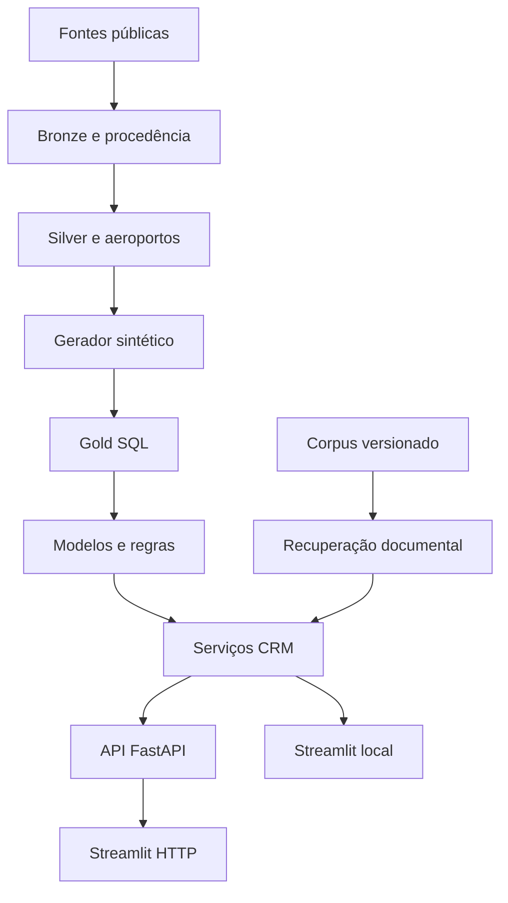

# Arquitetura, contratos e linhagem

## Decisão de implementação

FastAPI + Streamlit, Python 3.12. O domínio original permanece independente de HTTP e armazenamento. `CrmService` orquestra repositório, features, valor, risco, segmento e prioridade. O gateway Streamlit permite usar os mesmos serviços diretamente ou via HTTP.

`Store` escolhe SQLite para demonstração ou Snowflake para persistência analítica principal. O backend é explícito; falhas Snowflake não acionam fallback. As tabelas armazenam ID e payload canônico JSON/VARIANT, com visões SQL tipadas para consulta. Esse desenho preserva contratos e facilita evolução, mas não substitui modelagem relacional otimizada para grandes volumes.

## Tabelas

| Camada/tabela | Chave e conteúdo | Origem |
|---|---|---|
| BRONZE.SOURCES | hash, dataset, período, URL, data, contagens | Manifesto de ingestão |
| BRONZE.RAW_ROWS | hash + linha, campos sem transformação | CSV original |
| SILVER.AIRPORTS | ID da fonte, ICAO/IATA, nome, localização, versão | OurAirports |
| SILVER.FARES | hash dos campos de entrada, mês venda, empresa, ICAO/IATA, tarifa e assentos | Tarifas ANAC |
| SILVER.OPERATIONS | hash da linha, datas, atraso, cancelamento, ICAO/IATA | VRA ANAC |
| SILVER.DEMAND | Estrutura reservada, não alimentada nesta versão | Pendente |
| GOLD.CUSTOMERS | customer_id, aeroporto, canal, tier demonstrativo, is_synthetic | Gerador |
| GOLD.TRIPS | trip_id, customer_id, rota, data, receita em dinheiro, atraso | Gerador |
| GOLD.FEATURES | customer_id, gasto, frequência, recência, incident_rate, corte | FeatureBuilder |
| GOLD.LOYALTY | cliente, saldo inicial/acúmulo/resgate/saldo, pagamentos, tier simulado | Gerador separado |
| GOLD.OUTCOMES | cliente, janela futura, datas simuladas, contagem, churn | Sorteio probabilístico |
| GOLD.SCORES | cliente, valor, risco, prioridade, fatores, versão | `sync-scores` |
| GOLD.MANIFEST | current, versão, seed, janelas, escopo da calibração | Publicação |
| GOLD.DECISIONS | UUID, cliente, recomendação congelada, decisão, nota, data, sent=false | Revisão humana |

O arquivo bruto também é preservado em `data/bronze/<dataset>/<hash>`. O banco contém linhas e procedência; um novo formato pode ser reprocessado a partir do bruto. Tarifas e VRA preservam códigos originais e status `matched`, `unknown`, `without_iata` ou `ambiguous`. A versão do mapeamento é gravada em cada registro tratado. Códigos não resolvidos permanecem na Silver; o gerador público usa apenas rotas resolvidas.

CSV v1 continua como exportação/compatibilidade. A API v2 usa SQL quando há manifesto SQL. O caminho legado de bootstrap permite executar os testes/contratos v1; não é fallback por falha de conexão Snowflake.

## Integridade e atualização

- Download HTTPS em arquivo temporário, limite de bytes, timeout, três tentativas e SHA-256.
- Cache reutilizado apenas se o hash local continuar correto; `--refresh` força nova obtenção para detectar revisões.
- ZIP aceita um CSV e limita tamanho descompactado. HTML de bloqueio é rejeitado.
- Hash repetido evita recarga; revisão mensal substitui a Silver da competência, preservando Bronze anterior.
- Duplicatas exatas são preservadas na Bronze e deduplicadas na Silver sem somar assentos em dobro.
- Manifesto de ingestão e Silver são publicados na mesma transação. Arquivos Bronze podem existir se o banco falhar; a ausência do manifesto permite repetir a carga.
- Snapshots Gold são publicados em uma transação. `demo` substitui entidades sintéticas e limpa decisões/scores do snapshot anterior. Use apenas uma execução de carga por vez.
- O carregador em memória é adequado ao MVP, não a todo o histórico nacional de uma vez: limite padrão do download 50 MiB, leitura CSV/ZIP 100 MiB, até um milhão de linhas por importação. Aumentar volume exige carregamento por estágio/COPY e processamento em lotes de memória.
- A UI recarrega o snapshot por comando explícito, reduzindo consultas/custo.

## Formatos de entrada

Tarifas tradicionais: `nr_ano_referencia`, `nr_mes_referencia`, `sg_empresa_icao`, `sg_icao_origem`, `sg_icao_destino`, `nr_tarifa`, `nr_assentos`. UTF-8/BOM ou Latin-1; delimitador vírgula/ponto e vírgula. Tarifa deve ser positiva e finita; assentos inteiros positivos. Mês e ano validados em todas as linhas. Campos extras ficam na Bronze.

VRA: `Sigla ICAO Empresa Aérea`, `Número Voo`, `Sigla ICAO Aeroporto Origem`, `Sigla ICAO Aeroporto Destino`, `Partida Prevista`, `Partida Real`, `Situação Voo` ou `Situação do voo`. A comparação de cabeçalhos normaliza acentos/caixa. São aceitas datas brasileiras com minutos/segundos e ISO sem offset; a interpretação é America/Sao_Paulo conforme documentação VRA. Ausências ficam nulas. Datas inválidas ou fora do período solicitado impedem publicação.

OurAirports: `ident`, `iata_code`, `name`; localização e `icao_code` quando disponíveis. `ident` é fallback para ICAO de quatro caracteres. Ambiguidades não são resolvidas por preferência silenciosa. O recorte de dez aeroportos foi obtido de download real; `airports_reference.source.json` registra URL, hash do arquivo integral e data. O hash do recorte é diferente do integral por definição.

## Pontuação e simulação

- Valor = 100 × (0,5 × gasto normalizado + 0,3 × frequência normalizada + 0,2 × recência normalizada). Referências e limites em `config/settings.toml`.
- Baseline risco = min(0,95; 0,1 + 0,6 × min(recência/180; 1) + 0,25 × taxa de incidentes). É índice heurístico, não probabilidade calibrada.
- Prioridade = valor × risco.
- `estimated_value_at_risk` da API v1 mantém semântica original: gasto observado × risco.
- `clv_12m_proxy` da v2 = gasto anualizado no recorte × (1 − 0,5 × risco). É hipótese de receita, sem margem, taxa de desconto ou calibração real.
- `weighted_value_at_risk` = proxy × índice/probabilidade. Com baseline, não é perda esperada probabilística validada.
- **Atualização:** o CLV exibido no app e usado no cenário é o CLV de 12 meses por margem, com desconto e risco de evasão (`clv_12m`, `clv_at_risk`, `potential_value_12m`), definido em `docs/CLV.md`. Os campos `clv_12m_proxy` e `weighted_value_at_risk` continuam na API só por compatibilidade.
- Simulador: custo = público × custo unitário; valor hipotético protegido = valor em risco × retenção assumida; saldo = protegido − custo. Ponto de equilíbrio nulo quando não há valor. Nenhuma alegação causal.
- Os filtros de período/rota mudam a população e as viagens utilizadas nos indicadores. Scores mantêm a janela contratual para não aplicar modelo fora do contrato; essa distinção aparece na UI.

## Dados sintéticos e modelos

Observação padrão: 01/10/2025–30/09/2026. Desfecho: 01/10/2026–31/03/2027. Datas futuras são simuladas, não fatos observados.

O gerador original cria frequências contrastantes e rotas de fixtures. A extensão simula resgates em 12% das viagens; entre as demais, 15% têm desconto restrito hipotético de 20%. Receita em dinheiro é zero no resgate, e a tarifa de referência é preservada separadamente; não se afirma que a base pública contém resgates. Pontos usam taxa fictícia de 3 por real e resgate de 50 por real de referência. Saldo inicial cobre resgates e há validação contábil. Tiers simulados não determinam elegibilidade oficial.

A propensão de churn sintético combina recência, incidentes, intercepto e fator oculto normal de desvio 0,9. Um sorteio gera desfecho; clientes evadidos têm zero viagens na janela futura. Somente features da observação entram na regressão. Isso evita usar o rótulo/futuro diretamente, mas não elimina a artificialidade da distribuição gerada.

Scaler ajustado no treino; escolha entre modelo e regra por validação cruzada em treino + validação (ver `docs/MODELO_CHURN.md`); teste reservado. Relatório inclui ROC-AUC, average precision (nomeada PR-AUC no JSON), Brier, precisão, recall e matriz de confusão. AUC > 0,95 bloqueia promoção para investigação. Essa regra é triagem, não prova de ausência de vazamento. Não há ajuste automático de hiperparâmetros nem busca de seeds por resultado.

Coeficientes e scaler são serializados em JSON, sem pickle. Fingerprint da Gold evita usar artefato de outro snapshot. A inferência é leve e usa as portas originais. Modelo de CLV treinado, SHAP e clustering não foram implementados.

## RAG e elegibilidade

`DocumentIndex` lê JSONs de documentos, fragmenta, calcula representações, recupera top 3 e aplica limiar. O modo lexical é extrativo. O modo Ollama persiste embeddings e valida fingerprint/modelo. A geração usa JSON e rejeita citações desconhecidas/ausentes. Não garante ausência de alucinação; exige avaliação humana.

O catálogo de contatos continua independente do LLM. Sem evidência não há ação. Sem regulamento/elegibilidade verificados não há concessão de upgrade/pontos. Perguntas selecionadas sobre um cliente retornam fatos estruturados, sem cálculos pelo LLM. Não há execução externa nem envio de campanha.

## API

Prefixo `/api/v1`; contratos antigos preservados:

| Método | Rota | Comportamento |
|---|---|---|
| GET | /metadata | Proveniência, janelas, método e persistência |
| GET | /customers | Paginação offset/limit |
| GET | /customers/{id} | Cliente, viagens e scores |
| GET | /customers/{id}/scores | Contrato original |
| GET | /customers/{id}/recommendations | Rascunho e evidências |
| GET | /retention/priorities | Ordenação, filtro de segmento |
| GET | /segments | Contagens |
| POST | /agent/recommend | Recomendação pelo catálogo |
| GET | /dashboard | Recorte, KPIs e linhas |
| POST | /agent/ask | Consulta documental ou fatos do cliente |
| POST | /simulations | Hipóteses, custo e equilíbrio |
| POST | /decisions | Registro APPROVED/REJECTED, nunca envio. APPROVED exige `confirmed_checklist` com os itens da recomendação (consentimento, revisão humana) |
| GET | /customers/{id}/loyalty | Fidelidade demonstrativa |
| GET | /models | Métricas/seleção |

`/health` permanece fora do prefixo. A API produz OpenAPI em `/openapi.json`. Arquivos estáticos em `docs/legacy/api` refletem a versão anterior. Não usar como contrato atual das extensões.

## Critérios do desafio

O fluxo local demonstra identificação, explicação, segmentação, decisão e revisão responsável com dados sintéticos. A arquitetura permite substituir o repositório e os contratos Gold. A qualidade técnica fica evidenciada por testes e resultados reportados sem inflá-los. Para satisfazer integralmente a proposta funcional, ainda faltam as integrações reais e itens listados na validação; especialmente benefícios verificados do programa de fidelidade, agente com LLM, calibração do comportamento individual do cliente e submissão. O pitch deve explicar essas fronteiras, sem repetir alegações de SHAP/calibração presentes no PDF de concorrência como se já fossem fatos.
