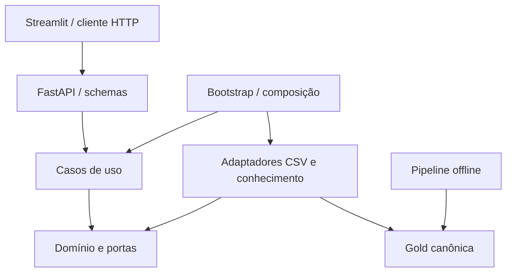

> HISTÓRICO: preservado do ZIP original. Para comandos e status atuais use ../README.md.

# Inteligência de CRM — Azul + Avanade

Esqueleto executável do MVP do Hacka Business 2026. A proposta é identificar clientes de alto valor, explicar sinais de evasão e apoiar decisões de relacionamento. Este pacote entrega a base técnica para o time trabalhar em paralelo; **não representa o MVP analítico final**.

**Uso restrito ao time e aos avaliadores. O repositório deve ser privado.** O enunciado exige confidencialidade e atribui à Azul a propriedade intelectual do produto final. Não publicar este material em redes sociais, portfólio ou repositório público.

## 1. O que funciona nesta versão

- Pipeline reproduzível com seed: fixture de rotas → Bronze → Silver → clientes, viagens e features na Gold.
- Customer Value Score parametrizado, índice heurístico de risco, quatro segmentos por regras e priorização.
- FastAPI com contratos validados, documentação OpenAPI, erros 404/422 e paginação de clientes.
- Streamlit com filtros, fila de prioridades, indicadores, cliente 360 e recomendações.
- Recuperação lexical de documento **fictício** e redação por template com revisão humana obrigatória.
- Testes de integração da API, reprodução dos dados e proteção da janela de features contra dados futuros.

| Capacidade do MVP | Situação deste esqueleto | Próxima entrega |
|---|---|---|
| ANAC Bronze/Silver | Pipeline local com fixture fictícia | Larissa: fontes reais, mapeamento e perfilamento |
| Base sintética calibrada | Gerador determinístico de integração, sem calibração | Nathália + Larissa: calibração e validação pública |
| Valor e prioridade | Baselines explícitos e configuráveis | Nathália: revisar premissas e publicar scores |
| Churn de ML | Índice heurístico, sem treino nem métricas | Nathália: desfecho probabilístico futuro, treino e avaliação |
| Personas | Quatro grupos por regras | Larissa: segmentação orientada por dados |
| Explicabilidade | Componentes do baseline em texto | Nathália: SHAP e versão do modelo treinado |
| RAG e LLM | Recuperação lexical + template de demonstração | Davi: regras verificadas, índice e provedor de LLM |
| Dashboard/API | Fluxo local integrado | Ingrid + Davi: evoluir telas e contratos |
| Sentimento/simulador | Não implementados; extras | Davi / Ingrid, após estabilizar o núcleo |
| Deploy | Execução local e CI | Davi: ambiente restrito e link para avaliação |

As tarifas da fixture são valores inventados. Os clientes não correspondem a pessoas reais. Nenhuma política oficial de fidelidade está incorporada. Não há coleta automática, disparo de mensagens ou concessão de benefícios.

## 2. Stack e decisão de repositório

- **Python 3.11 a 3.13**, recomendado 3.11 para o time e usado no CI.
- **Back-end: FastAPI + Uvicorn**, com schemas de entrada e saída Pydantic.
- **Front-end: Streamlit**, inteiramente escrito em Python; usa HTTPX para consultar a API.
- **Dados:** CSV e JSON no MVP local; portas permitem adaptação futura a Parquet/Snowflake.
- **Análise tabular da UI:** pandas. O domínio não depende dele.
- **Qualidade:** pytest e Ruff. Grupo opcional `ml`: scikit-learn, SHAP e PyArrow para as próximas tasks.

Foi escolhido um **monorepositório modular**: um time pequeno e um prazo curto se beneficiam de contratos, configuração e CI no mesmo PR. FastAPI e Streamlit são processos independentes. O dashboard não acessa o lake nem importa modelos de negócio. Não há JavaScript ou React escritos pelo time nesta base.

## 3. Como executar

### Pré-requisitos

Instale Python 3.11 e Git. Extraia o ZIP e abra um terminal **dentro de `azul-crm/`**, onde está o `pyproject.toml`. Não execute os comandos de dentro de `src/`.

### Windows — PowerShell

```powershell
py -3.11 -m venv .venv
.\.venv\Scripts\python.exe -m pip install --upgrade pip
.\.venv\Scripts\python.exe -m pip install -e ".[dev]"
.\.venv\Scripts\python.exe -m azul_crm.pipeline.cli demo --seed 42 --customers 40
.\.venv\Scripts\python.exe -m uvicorn azul_crm.api.main:app --reload --host 127.0.0.1 --port 8000
```

Mantenha o terminal da API aberto. Em **outro terminal**, na mesma pasta:

```powershell
.\.venv\Scripts\python.exe -m streamlit run frontend/app.py --server.port 8501
```

Esses comandos usam o Python do ambiente diretamente e dispensam alteração da política de execução do PowerShell.

### Linux/macOS

```bash
python3.11 -m venv .venv
source .venv/bin/activate
python -m pip install --upgrade pip
python -m pip install -e ".[dev]"
python -m azul_crm.pipeline.cli demo --seed 42 --customers 40
python -m uvicorn azul_crm.api.main:app --reload --host 127.0.0.1 --port 8000
```

Em outro terminal, na raiz:

```bash
source .venv/bin/activate
python -m streamlit run frontend/app.py --server.port 8501
```

Abra:

- Dashboard: <http://localhost:8501>
- Swagger/API: <http://localhost:8000/docs>
- Saúde: <http://localhost:8000/health>
- Metadados e limitações: <http://localhost:8000/api/v1/metadata>

A instalação precisa de internet para baixar os pacotes; **depois disso, a demonstração não exige internet nem chave de IA**. `requirements.txt` equivale à instalação base por `python -m pip install -r requirements.txt`. Para as futuras tarefas de ML, instale `python -m pip install -e ".[dev,ml]"`.

### Configuração

`config/settings.toml` contém pesos e referências do value score. Os pesos devem somar 1. Reinicie a API ao alterar configuração ou regenerar Gold: o repositório carrega um snapshot no startup.

| Variável de ambiente | Padrão | Uso |
|---|---|---|
| `CRM_API_URL` | `http://127.0.0.1:8000` | Endereço que o Streamlit consulta |
| `CRM_PROJECT_ROOT` | Raiz identificada a partir do código | Configuração, lake e fixtures de outra pasta |

Exemplo PowerShell: `$env:CRM_API_URL = "http://127.0.0.1:8001"`. Linux/macOS: `export CRM_API_URL=http://127.0.0.1:8001`. Não existe carregamento automático de `.env` nesta versão; as duas variáveis são lidas do ambiente do processo. Não inclua segredos no TOML. Futuras chaves do LLM devem vir do ambiente ou de um gerenciador de segredos.

### Verificação

```bash
python -m pytest -q
python -m ruff check .
```

No Windows, use `.\.venv\Scripts\python.exe` no lugar de `python`. Os testes usam uma Gold temporária e não alteram seus arquivos. O pipeline foi verificado com dados de demonstração e o frontend com o AppTest do Streamlit; Windows e publicação remota não foram executados neste ambiente.

### Problemas frequentes

- **Gold ausente:** execute o comando `demo` antes de iniciar Uvicorn.
- **ModuleNotFoundError:** execute `pip install -e ".[dev]"` com o mesmo Python usado para iniciar a API.
- **API indisponível no dashboard:** confirme porta, processo Uvicorn e `CRM_API_URL` no terminal do Streamlit.
- **Porta ocupada:** altere `--port` do Uvicorn e ajuste `CRM_API_URL`; para a UI, altere `--server.port`.
- **Dados antigos:** reinicie Uvicorn após rodar novamente o pipeline.
- **Deploy:** `127.0.0.1` refere-se ao próprio servidor. A UI precisa receber a URL alcançável da API. O protótipo não tem autenticação: Davi deve configurar acesso restrito, HTTPS e segredos antes de expor a aplicação.

## 4. Arquitetura e direção das dependências



O domínio contém contratos e regras de negócio. A aplicação coordena essas regras. Adaptadores conhecem arquivos e mecanismos de recuperação. A API traduz HTTP para casos de uso. O bootstrap decide quais implementações usar e as injeta. O pipeline roda separadamente do atendimento HTTP; não treine modelos nem baixe ANAC durante uma requisição.

As pastas Bronze/Silver/Gold representam **maturidade dos dados**. Domínio/aplicação/infraestrutura representam **responsabilidades do software**. São divisões diferentes e complementares.

### SOLID, POO e Clean Code na prática

| Princípio | Aplicação concreta |
|---|---|
| Responsabilidade única | `FeatureBuilder` calcula features; `ValueScorer` calcula valor; `CsvCustomerRepository` lê Gold; `CrmApiClient` lida com HTTP |
| Aberto/fechado | Trocar CSV por Snowflake implementando `CustomerRepository`; trocar churn implementando `ChurnPredictor` |
| Substituição de Liskov | Adaptadores devem preservar contratos, intervalos, exceções e significado dos campos; testes de contrato devem acompanhar novos adaptadores |
| Segregação de interfaces | Portas pequenas para clientes, churn, segmentação, recuperação e geração de mensagem |
| Inversão de dependência | Aplicação recebe `Protocol`s e serviços por construtor; apenas `bootstrap.py` escolhe os adaptadores concretos |
| Orientação a objetos | Entidades imutáveis, encapsulamento dos adaptadores e composição de serviços; sem hierarquias de herança artificiais |
| Clean Code | Nomes explícitos, funções focadas, configuração fora das fórmulas, erros de domínio separados de HTTP e ausência de estado global mutável de negócio |

Os `Protocol`s usam tipagem estrutural: um adaptador não precisa herdar de uma classe para cumprir o contrato. Dataclasses expressam os objetos de domínio sem acoplamento ao Pydantic. Os testes concretos ajudam a preservar o comportamento; nomes de pastas, isoladamente, não garantem SOLID.

## 5. Estrutura e responsabilidades

```text
azul-crm/
├── src/azul_crm/
│   ├── domain/          # Entidades, portas e regras puras
│   ├── application/     # Features e casos de uso de CRM/recomendação
│   ├── infrastructure/  # CSV, recuperação lexical, templates e settings
│   ├── api/             # Rotas FastAPI, schemas e tratamento HTTP
│   ├── pipeline/        # CLI e etapas offline de demonstração
│   └── bootstrap.py     # Injeção das implementações
├── frontend/            # Streamlit e cliente HTTP
├── data/
│   ├── fixtures/        # Amostras fictícias pequenas, versionadas
│   ├── bronze/          # Entrada bruta e procedência
│   ├── silver/          # Rotas padronizadas
│   └── gold/            # Clientes, viagens, features e manifest
├── artifacts/           # Futuras métricas, modelos e relatórios
├── config/              # Hipóteses de scoring
├── docs/                # Contratos, roadmap e evolução
├── tests/               # Domínio temporal, integração e guardrails
└── .github/             # CI e template de PR
```

### Classes e arquivos

| Arquivo | Classes / funções | O que fazem |
|---|---|---|
| `domain/models.py` | `Customer`, `Trip` | Cliente canônico e viagem; validam invariantes básicas |
| Mesmo arquivo | `Features`, `RiskEstimate`, `Scores` | Entradas analíticas e saída versionada de valor/risco/prioridade |
| Mesmo arquivo | `Evidence`, `Action`, `Recommendation` | Documento recuperado, ação selecionada e rascunho com evidências |
| `domain/ports.py` | `CustomerRepository` | Contrato de leitura de clientes e viagens |
| Mesmo arquivo | `ChurnPredictor`, `Segmenter` | Contratos substituíveis de risco e classificação |
| Mesmo arquivo | `KnowledgeRetriever`, `MessageGenerator` | Contratos da busca documental e da redação |
| `domain/scoring.py` | `ScoringPolicy` | Valida pesos, referências e limiares |
| Mesmo arquivo | `ValueScorer` | Combina gasto, frequência e recência normalizados |
| Mesmo arquivo | `BaselineChurnPredictor` | Índice heurístico de risco; nunca tratado como probabilidade calibrada |
| Mesmo arquivo | `RuleSegmenter`, `PriorityScorer` | Segmenta por valor/risco e ordena prioridades |
| `domain/decisions.py` | `EligibilityPolicy` | Bloqueia sem evidência; permite apenas rascunhos de contato, sem benefício |
| `application/features.py` | `FeatureBuilder` | Calcula features somente entre início e fim da observação |
| `application/crm.py` | `CrmService`, `CustomerNotFound` | Busca cliente, calcula scores e monta fila; sinaliza cliente inexistente |
| `application/recommendations.py` | `RecommendationService` | Busca contexto, recupera evidências, filtra ação e redige rascunho |
| `infrastructure/csv_repository.py` | `CsvCustomerRepository` | Lê snapshot Gold e valida IDs/relacionamentos |
| `infrastructure/knowledge.py` | `JsonKnowledgeRetriever` | Recuperação lexical simples de documentos JSON |
| Mesmo arquivo | `TemplateMessageGenerator` | Template local que cumpre a porta de geração sem API externa |
| `infrastructure/settings.py` | `Settings` | Resolve caminhos e carrega parâmetros TOML |
| `bootstrap.py` | `Container`, `build_container` | Monta dependências a partir da Gold e dos metadados |
| `api/schemas.py` | `ApiModel`, modelos `*Response`, `CustomerPage`, `RecommendationRequest` | Serialização HTTP, limites e contrato; não contêm regras de negócio |
| `api/routes.py` | `get_container`, handlers | Recebem requisições e delegam à aplicação |
| `api/main.py` | `create_app`, lifespan | Inicialização, endpoint de saúde e tradução de erro para 404 |
| `pipeline/stages.py` | `FixtureIngestor` | Copia fixture para Bronze e registra SHA-256 |
| Mesmo arquivo | `RouteCleaner` | Normaliza rotas e remove duplicatas na Silver |
| Mesmo arquivo | `DemoSyntheticGenerator` | Gera contas/viagens determinísticas para integração |
| Mesmo arquivo | `GoldPublisher`, `write_csv` | Publica CSVs e manifest versionado |
| `pipeline/cli.py` | `main` | Orquestra etapas offline com seed e quantidade de clientes |
| `frontend/api_client.py` | `CrmApiClient` | Encapsula URL, timeout e erros HTTP |
| `frontend/app.py` | Composição das telas | Renderiza filtros, indicadores, detalhes e rascunho; não calcula scores |

Consulte [docs/CONTRATOS.md](docs/CONTRATOS.md) para o dicionário e exemplos da API, [docs/PLANO_DE_TRABALHO.md](docs/PLANO_DE_TRABALHO.md) para responsáveis e [docs/EVOLUCAO.md](docs/EVOLUCAO.md) para os próximos adaptadores e critérios de conclusão.

## 6. Dados e fórmulas iniciais

A observação de demonstração vai de **01/10/2025 a 30/09/2026**. Todos os scores exibidos usam esse corte, não a data do computador. `evaluated_at` representa o corte analítico nesta versão.

- **Value Score:** `100 × (0,5 × min(gasto/18000,1) + 0,3 × min(frequência/24,1) + 0,2 × max(0,1-recência/180))`.
- **Risco heurístico:** `min(0,95; 0,1 + 0,6 × min(recência/180,1) + 0,25 × taxa_incidentes)`.
- **Priority Score:** `Value Score × risco`, usado apenas para a fila inicial.
- **Valor em risco aproximado:** gasto observado × risco. É um proxy de demonstração baseado em gasto passado; **não é CLV previsto, receita retida ou retorno causal**.
- **Segmentos:** cruzamento dos limiares de valor/risco. Nomes e cortes são hipóteses de demonstração, sem estereótipos pessoais.

O contrato mantém `churn_risk` no intervalo [0,1] para facilitar integração futura. Enquanto o baseline estiver ativo, a interface e `/metadata` deixam explícito que esse número é um índice, não uma probabilidade validada.

## 7. Fluxo de demonstração

1. Execute pipeline, API e dashboard.
2. Veja a tabela ordenada por prioridade e filtre por segmento.
3. Abra um cliente em **Cliente 360** e examine viagens e fatores do score.
4. Na aba **Recomendação**, gere um rascunho.
5. Confira a fonte fictícia e o status `DRAFT_REQUIRES_REVIEW`.
6. Explique quais componentes serão substituídos nas tasks de dados, ML e RAG.

## 8. Repositório e colaboração

Luan deve criar o repositório privado antes do envio. Com o GitHub vazio, na raiz do projeto:

```bash
git init
git add .
git commit -m "chore: estrutura inicial do CRM (HAC-5)"
git branch -M main
git remote add origin <URL_DO_REPOSITORIO_PRIVADO>
git push -u origin main
```

Substitua o marcador pela URL real. Se já existe repositório, copie o conteúdo para uma branch de trabalho sem executar um novo `git init`. Branches devem referenciar a task, como `hac-8-gerador-sintetico`. Faça PR com pelo menos uma revisão, commits pequenos e integração diária. O Linear continua sendo a fonte da verdade das tarefas; este pacote não altera o Linear.

Não versionar Gold, Bronze ou Silver geradas, credenciais ou artefatos grandes. Fixtures pequenas ficam no Git. Antes do envio, registre versões efetivas das dependências no ambiente do time; os intervalos do `pyproject.toml` não são um lockfile. Versões usadas na verificação deste pacote constam em `docs/VALIDACAO.md`.
